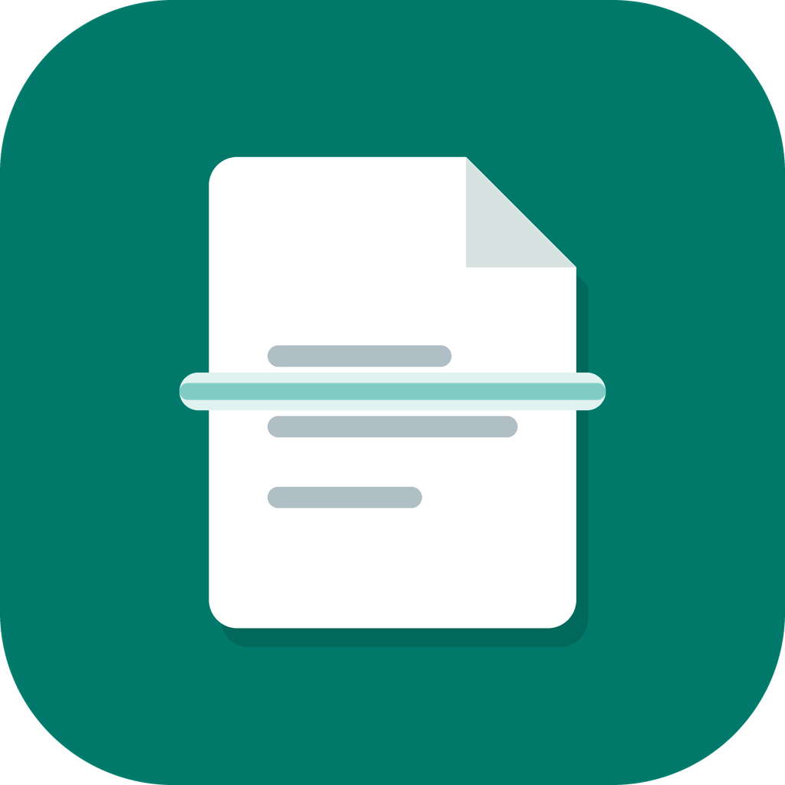
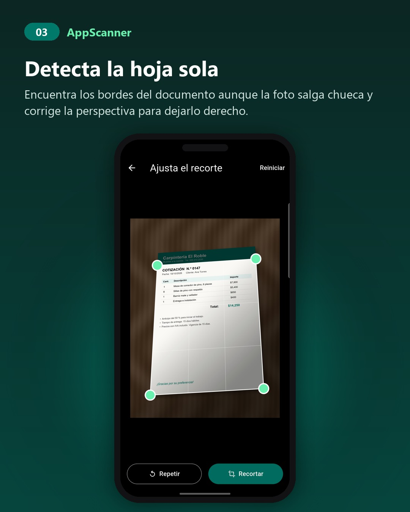
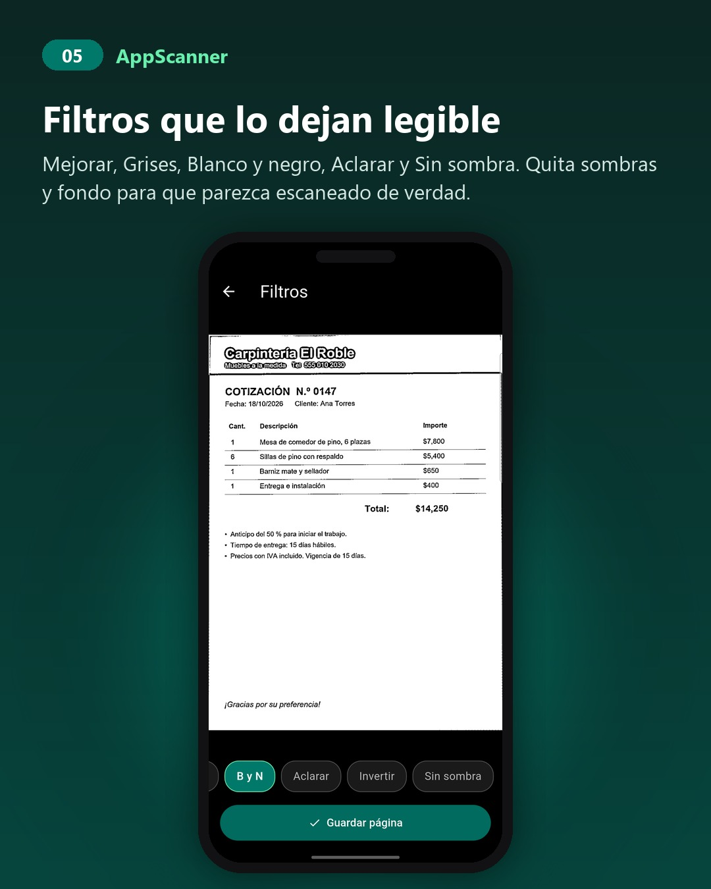
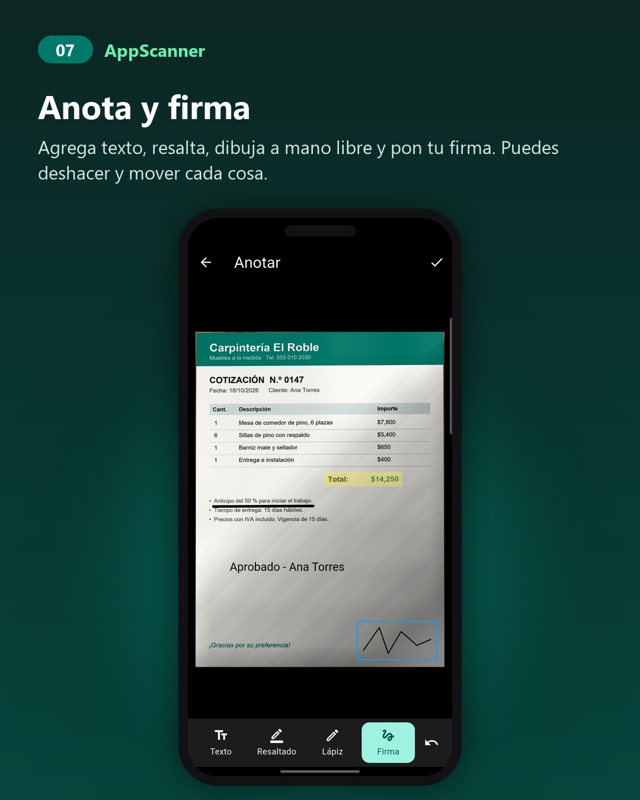
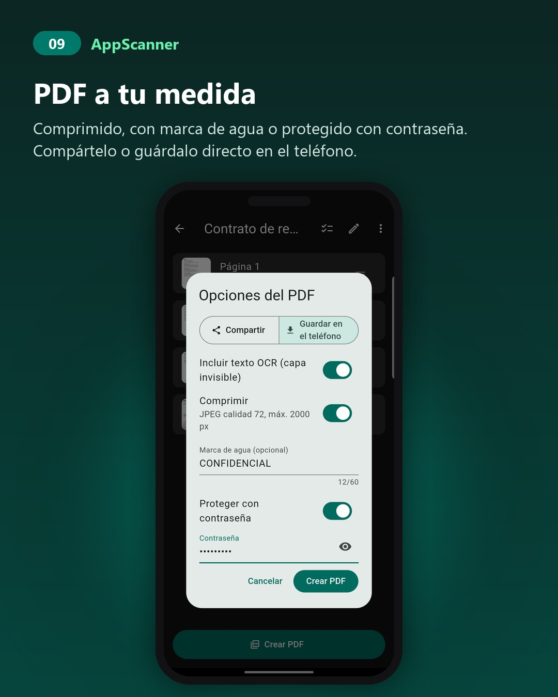

<p align="center">
  
</p>

# AppScanner

Escáner de documentos para Android hecho con Flutter. Toma fotos de hojas, credenciales o tarjetas, las endereza, las limpia, reconoce el texto y las exporta a PDF. **Todo se procesa en el teléfono**: no hay servidor, cuentas ni anuncios.

<p align="center">
  
  
  
  
</p>

Más capturas en [docs/capturas](docs/capturas).

## Qué hace

**Captura**
- Cámara con marco guía y modos Docs, ID, Tarjeta y Diapositivas.
- Modo ID: captura frente y reverso y los acomoda en una sola hoja A4.
- Disparo automático: detecta la hoja y dispara solo cuando está quieta, con el contorno dibujado en vivo.
- Modo lote: recorta y aplica el filtro automáticamente para escanear muchas hojas seguidas.
- Importa fotos de la galería y PDFs existentes.

**Edición**
- Recorte con corrección de perspectiva, esquinas arrastrables y lupa.
- Filtros: Original, Mejorar, Grises, B y N, Aclarar, Invertir, Sin sombra.
- Rotar, anotar (texto, resaltado, lápiz, firma) y deshacer.
- Visor con deslizamiento entre páginas y zoom.

**Documentos**
- Historial persistente, renombrar, buscar por el texto reconocido.
- Reordenar, duplicar, mover, copiar, extraer y eliminar páginas.
- OCR en el dispositivo (ML Kit, alfabeto latino) con texto copiable.

**PDF**
- PDF A4 multipágina con capa de texto invisible alineada palabra por palabra, así el PDF se puede buscar y seleccionar.
- Opciones: compresión, marca de agua y protección con contraseña (AES-256).
- Compartir, guardar en el teléfono o compartir las páginas como imágenes.

## Compilar

Requisitos: Flutter 3.47 o superior, Android SDK 36 y JDK 17 o superior.

```bash
flutter pub get
flutter analyze
flutter build apk --debug --target-platform android-arm64
```

Usa siempre `--target-platform android-arm64` mientras desarrollas. Sin ese flag Flutter compila OpenCV para cuatro arquitecturas y el build tarda más de 45 minutos.

Instalar en un teléfono conectado por USB:

```bash
adb install -r build/app/outputs/flutter-apk/app-debug.apk
```

`flutter test` necesita un compilador de C++ en la PC (en Windows, Visual Studio Build Tools con "Desarrollo de escritorio con C++"), porque `opencv_dart` compila código nativo para el host.

### Versión de release firmada

1. Crea tu propia clave de firma, fuera del repositorio:
   ```bash
   keytool -genkeypair -v -keystore mi-clave.jks -alias mi-alias -keyalg RSA -keysize 2048 -validity 10000
   ```
2. Copia `android/key.properties.example` a `android/key.properties` y llena las rutas y contraseñas. Ese archivo está en `.gitignore` y nunca debe subirse.
3. Compila:
   ```bash
   flutter build appbundle --release --target-platform android-arm64
   ```

Si no existe `key.properties`, el release se firma con la clave de debug para que el build no se rompa.

## Estructura

```
lib/
  models/     sesiones, páginas, anotaciones, opciones del PDF
  screens/    cámara, recorte, filtros, páginas, visor, anotar, OCR, inicio
  services/   detección de bordes, filtros, OCR, PDF, almacenamiento, importación
  widgets/    pintores del marco guía, lupa, diálogos
tool/         script para verificar la capa de texto del PDF
docs/         plan de implementación y bitácora de pruebas
assets/icon/  ícono y splash, con el script que los genera
```

El detalle de la arquitectura, el formato de almacenamiento (`session.json`) y lo que se probó en dispositivo está en [docs/PLAN-IMPLEMENTACION.md](docs/PLAN-IMPLEMENTACION.md).

## Dependencias con licencias a revisar

La mayoría de las dependencias son libres. Dos tienen condiciones propias:

- **`syncfusion_flutter_pdf`** (protección con contraseña): usa la licencia Community de Syncfusion, gratis para personas y empresas pequeñas. Una empresa grande que distribuya la app necesita una licencia de Syncfusion.
- **Google ML Kit** (OCR): SDK gratuito de Google sujeto a sus propios términos de uso.

## Licencia

MIT. Ver [LICENSE](LICENSE). Puedes usar, modificar y redistribuir el código; solo conserva el aviso de copyright.
